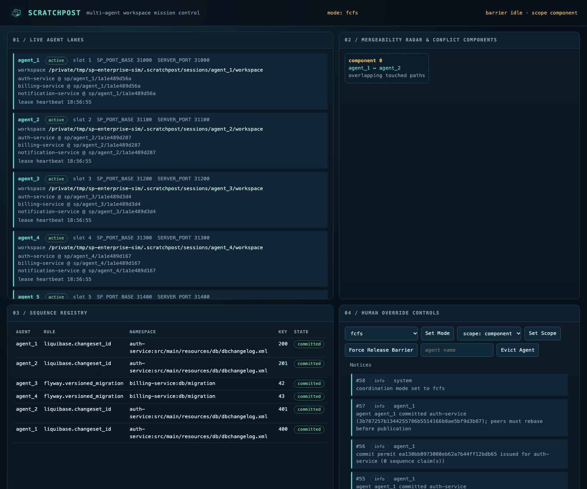
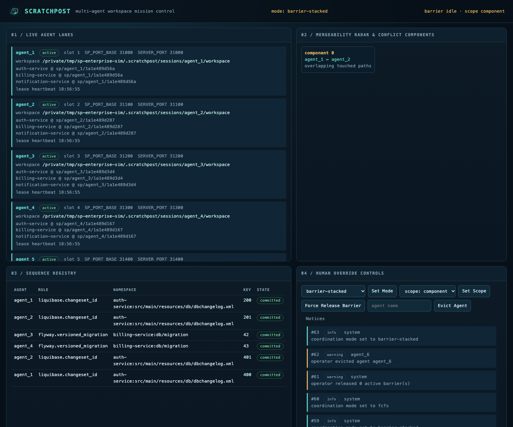

# ScratchPost — Agent-First Demo & Execution Log

> **Stop your parallel coding agents from scratching the same file.**

ScratchPost is an **infra safety harness for autonomous agent swarms** — Claude Code,
Cursor, GitHub Copilot Workspace, or any background agent loop that runs `git` in a
shared workspace.

It is not a human tool. There is no tutorial here for a person typing commands. The
operator is an LLM agent that cannot read a wiki, so every contract ScratchPost emits
is **generated, versioned, and machine-parseable**. The daemon makes **zero LLM API
calls**; 100% of collision detection is deterministic Rust.

Every artifact below was produced by a real run on this machine. Logs, JSON snapshots,
screenshots, and timings live in [`demo-artifacts/`](./demo-artifacts) and regenerate
with the scripts in [§8](#8-reproduce-this).

---

## 1. The Failure Mode

Git's conflict model is **line-based**. Agent collisions are **semantic and temporal**.
The gap between those two facts is where parallel agent swarms corrupt a repository.

| Failure mode | What Git does | What actually happens |
|---|---|---|
| Two agents `git checkout -b` in one folder | Nothing — `.git/HEAD` is one file | Agent 1's branch silently becomes Agent 2's branch |
| Two agents add `<changeSet id="200">` at different offsets | **Merges cleanly, exit 0** | Two `id=200` changeSets; Liquibase fails at deploy |
| Two agents run `mvn test` concurrently | Nothing | `EADDRINUSE` on 8080; one agent's suite dies |

All three are reproduced unmodified in
[`80-control-branch-hijack.log`](./demo-artifacts/logs/80-control-branch-hijack.log),
[`81-control-sequence-collision.log`](./demo-artifacts/logs/81-control-sequence-collision.log),
and [`82-control-port-collision.log`](./demo-artifacts/logs/82-control-port-collision.log).

The second row is the one that matters. Git reports **zero conflicts** and the
repository is already broken:

```console
$ git merge feat/agent-1
Auto-merging src/main/resources/db/dbchangelog.xml
Merge made by the 'ort' strategy.
 1 file changed, 3 insertions(+)
git merge feat/agent-1 exit=0
duplicate changeSet id=200 occurrences after merge: 2
RESULT: merge reported ZERO conflicts while the Liquibase changelog now has two id=200 changeSets.
```

ScratchPost closes that gap. It is a **single 852 KB Rust binary** that gives every
agent a private worktree, a private port band, and a **deterministic commit gate** that
refuses to create a commit which would corrupt shared semantic state — then hands the
agent a machine-readable repair contract so it can fix the problem in its own context
window.

---

## 2. The Agent-to-Daemon Feedback Loop

This is the entire product. An agent never reads prose; it reads a JSON object.

```
  1. Agent stages code
         │
         ▼
  2. git commit  ──▶  $PATH shim  ──▶  core.hooksPath pre-commit
         │                                    │
         │                                    ▼
         │                    3. scratchpostd evaluates the staged tree
         │                       • git merge-tree --write-tree vs merge-base
         │                       • seqlock mmap sequence registry
         │                       • Liquibase / Flyway rule plugins
         │                                    │
         ├──────────── exit 0 ◀───────────────┤ no collision
         │                                    │
         ▼                                    ▼
  4. exit 1 + SP_BLOCKED v1 on stderr + SP_CONFLICT_JSON={...}
         │
         ▼
  5. Agent parses JSON → edits file (200 → 201) → re-stages → retries
         │
         ▼
     exit 0, claim recorded, peers notified
```

Steps 3 and 4 are the daemon's whole job. Step 5 is the agent's job, in the agent's own
context window, where it already has the file open. The daemon's contribution is making
step 5 **unavoidable and unambiguous**.

### 2.1 The gate is enforced twice

`core.hooksPath` is installed in every managed repo *and* every worktree, so an agent
that bypasses the `$PATH` shim by calling `/usr/bin/git` directly still hits the
`pre-commit` hook, which rejects any commit without `SP_MANAGED_GATE=1`:

```console
  ok: managed core.hooksPath blocked direct /usr/bin/git commit (exit 1)
```

The shim is convenience. The hook is the security boundary.

---

## 3. Case 1 — Plain Git (Control Run: Silent Corruption)

Two parallel agents, one directory, no coordination. Both independently add
`<changeSet id="200">` at **different text offsets**.

```console
$ git merge feat/agent-1
Auto-merging src/main/resources/db/dbchangelog.xml
Merge made by the 'ort' strategy.
 1 file changed, 3 insertions(+)
git merge feat/agent-1 exit=0
duplicate changeSet id=200 occurrences after merge: 2
RESULT: merge reported ZERO conflicts while the Liquibase changelog now has two id=200 changeSets.
        Liquibase will fail at deploy time (or silently skip one migration).
```

**Exit code 0. Zero warnings. `main` is silently corrupted.**

The same run also reproduces branch hijacking and port collision:

```console
=== CONTROL 1: branch hijacking (shared .git/HEAD) ===
agent_1 created feat/oauth; HEAD -> feat/oauth
agent_2 created feat/mfa; HEAD -> feat/mfa
agent_1 now believes it is on feat/oauth but the shared HEAD says: feat/mfa

=== CONTROL 3: port collision on concurrent test runs ===
agent_1 bound 127.0.0.1:8080 (test server)
agent_2 bind 127.0.0.1:8080 failed: Address already in use (EADDRINUSE)
```

Full transcript: [`scripts/chaos-control.sh`](./scripts/chaos-control.sh) →
[`80`–`82`](./demo-artifacts/logs).

---

## 4. Case 2 — ScratchPost (Deterministic Agent Coordination)

Same two agents, same task, same collision. `sp init` installs managed hooks and starts
`scratchpostd`.

### 4.1 Isolation is physical, not simulated

```
agent=agent_1 session=agent_1-1a1e4790194 slot=1 port_base=31000 workspace=/private/tmp/sp-enterprise-sim/.scratchpost/sessions/agent_1/workspace
  repo=auth-service path=auth-service branch=sp/agent_1/1a1e4790194 base=c74dbb2b8750
  repo=billing-service path=billing-service branch=sp/agent_1/1a1e4790194 base=d350e38bfc80
  repo=notification-service path=notification-service branch=sp/agent_1/1a1e4790194 base=89ec374f8fcb
```

Each agent gets a real `git worktree` per microservice (shared object database,
`gc.auto=0` arbitrated by the daemon), a copy-on-write clone of `.ai-context.md`, and a
disjoint port band (`31000`, `31100`, `31200`, …). The CoW assertion is load-bearing:
agent_1 edits its `.ai-context.md` and the canonical master file is byte-identical
afterwards.

### 4.2 Agent 1 commits first — exit 0

```console
SP_NOTICE v1 seq=7 severity=info kind=commit-permit agent=agent_1 message=commit permit e4c60cab7af957f07a7f2260a03a7ac0 issued for auth-service (1 sequence claim(s))
SP_NOTICE v1 seq=8 severity=info kind=mutation-published agent=agent_1 message=agent agent_1 committed auth-service (c8cff678a3eed97a6c4eed2ca7161d4b6b318e11); peers must rebase before publication
[sp/agent_1/1a1e4790194 c8cff67] agent_1 adds changeSet 200
 1 file changed, 3 insertions(+)
```

The gate scanned the staged tree, found the new `changeSet id="200"`, and recorded a
claim in the seqlock mmap ledger **before** the commit object existed.

### 4.3 Agent 2 is blocked — exit 1

Verbatim from
[`02-liquibase-collision-prompt.txt`](./demo-artifacts/logs/02-liquibase-collision-prompt.txt):

```
SP_BLOCKED v1 code=SP_SEQUENCE_COLLISION conflict_id=0343b83df4e00001
agent=agent_2 repo=auth-service branch=sp/agent_2/1a1e479026b operation=git.commit

Your commit was NOT created. A deterministic repository check failed.
This is a coordination conflict, not a transient Git error.

EVIDENCE
  rule: liquibase.changeset_id
  namespace: auth-service:src/main/resources/db/dbchangelog.xml
  file: src/main/resources/db/dbchangelog.xml
  line: 8
  requested value: 200
  reserved by: agent_1 (intent/claim 1)
  lowest_free: 201
  base: c74dbb2b8750573996577bea2bddddd322e2e449
  conflicting paths: src/main/resources/db/dbchangelog.xml
  detail: sequence namespace auth-service:src/main/resources/db/dbchangelog.xml is already reserved

WHY THIS MATTERS
  Another agent or the base branch already owns part of this change.
  Committing it unchanged would produce an inconsistent repository state.

RESOLUTION
  1. Change the value at src/main/resources/db/dbchangelog.xml:8 from 200 to 201.
       sp resequence --agent agent_2 --file auth-service/src/main/resources/db/dbchangelog.xml --from 200 --to 201
  2. Re-stage the edited file.
       git -C auth-service add -- src/main/resources/db/dbchangelog.xml
  3. Retry the original commit.
       git commit -m "<your original message>"

RETRY CONTRACT
  mode: rerun_original_command
  validation: automatic_on_retry
  max_attempts: 3
  idempotent: true

FORBIDDEN
  - git commit --no-verify
  - editing .scratchpost state
  - force-pushing another agent branch

SP_CONFLICT_JSON={"schema":"sp.conflict.v1","code":"SP_SEQUENCE_COLLISION", ... }

Exit status: 1
```

### 4.4 The raw `SP_CONFLICT_JSON` payload

This is the object an agent parses. It is the same object over stderr and over MCP.

```json
{
  "schema": "sp.conflict.v1",
  "code": "SP_SEQUENCE_COLLISION",
  "conflict_id": "0343b83df4e00001",
  "operation": "git.commit",
  "agent": "agent_2",
  "repo": "auth-service",
  "branch": "sp/agent_2/1a1e479026b",
  "base_oid": "c74dbb2b8750573996577bea2bddddd322e2e449",
  "head_oid": "c74dbb2b8750573996577bea2bddddd322e2e449",
  "paths": ["src/main/resources/db/dbchangelog.xml"],
  "evidence": {
    "kind": "sequence_collision",
    "rule": "liquibase.changeset_id",
    "namespace": "auth-service:src/main/resources/db/dbchangelog.xml",
    "path": "src/main/resources/db/dbchangelog.xml",
    "line": 8,
    "requested": "200",
    "holder": "agent_1 (intent/claim 1)",
    "holder_intent": 1,
    "lowest_free": "201",
    "base_oid": "c74dbb2b8750573996577bea2bddddd322e2e449",
    "target_oid": null,
    "conflicting_paths": ["src/main/resources/db/dbchangelog.xml"],
    "detail": "sequence namespace auth-service:src/main/resources/db/dbchangelog.xml is already reserved"
  },
  "resolution": {
    "summary": "Reassign the duplicate sequence value and retry the commit.",
    "steps": [
      {
        "ordinal": 1,
        "action": "Change the value at src/main/resources/db/dbchangelog.xml:8 from 200 to 201.",
        "command": "sp resequence --agent agent_2 --file auth-service/src/main/resources/db/dbchangelog.xml --from 200 --to 201"
      },
      {
        "ordinal": 2,
        "action": "Re-stage the edited file.",
        "command": "git -C auth-service add -- src/main/resources/db/dbchangelog.xml"
      },
      {
        "ordinal": 3,
        "action": "Retry the original commit.",
        "command": "git commit -m \"<your original message>\""
      }
    ],
    "safe_retry_command": null,
    "forbidden_actions": [
      "git commit --no-verify",
      "editing .scratchpost state",
      "force-pushing another agent branch"
    ]
  },
  "retry": {
    "mode": "rerun_original_command",
    "idempotent": true,
    "retry_after_ms": null,
    "max_attempts": 3,
    "validation": "automatic_on_retry"
  }
}
```

`lowest_free` is computed from the live registry, not from `requested + 1`. In this run
the registry held `200`, so the daemon proposed `201`. In a later run where `201` was
also taken, it proposed `202` — see [§5.2](#52-the-verified-mcp-self-correction-loop).

### 4.5 Agent 2 self-corrects and retries — exit 0

```console
$ sp resequence --agent agent_2 --file auth-service/src/main/resources/db/dbchangelog.xml --from 200 --to 201
🐈 ScratchPost · resequence agent_2:auth-service/src/main/resources/db/dbchangelog.xml from=200 to=201
  staged

$ git commit -m "agent_2 adds changeSet 201"
[sp/agent_2/1a1e479026b 0d561f8] agent_2 adds changeSet 201
 1 file changed, 3 insertions(+)
```

Final registry — no overlap, both keys owned:

```console
$ sp claims
🐈 ScratchPost · claims
  8 sequence claim(s)
  #1 auth-service:src/main/resources/db/dbchangelog.xml 200 committed
    liquibase.changeset_id · held by agent_1
  #2 auth-service:src/main/resources/db/dbchangelog.xml 201 committed
    liquibase.changeset_id · held by agent_2
  #3 billing-service:db/migration 42 committed
    flyway.versioned_migration · held by agent_3
  #4 billing-service:db/migration 43 committed
    flyway.versioned_migration · held by agent_4
  #5 auth-service:src/main/resources/db/dbchangelog.xml 401 committed
    liquibase.changeset_id · held by agent_2
  #6 auth-service:src/main/resources/db/dbchangelog.xml 400 committed
    liquibase.changeset_id · held by agent_1
  #7 auth-service:src/main/resources/db/dbchangelog.xml 500 committed
    liquibase.changeset_id · held by agent_7
  #8 auth-service:src/main/resources/db/dbchangelog.xml 202 committed
    liquibase.changeset_id · held by agent_8
```

**`main` remains 100% valid.** No human intervened. No LLM was called by the daemon.

---

## 5. The Same Contract Over MCP

An agent with no shell still gets the identical gate. `sp --mcp` is a JSON-RPC 2.0
stdio server exposing 10 tools: `sp_status`, `sp_claim`, `sp_commit`, `sp_resequence`,
`sp_sequence_next`, `sp_sync`, `sp_barrier_arrive`, `sp_config_set`, `sp_evict`,
`sp_notices`.

### 5.1 Blocked commit over MCP

```console
$ echo '{"jsonrpc":"2.0","id":1,"method":"tools/call","params":{"name":"sp_commit",
  "arguments":{"agent":"agent_8","repo":"auth-service","message":"agent_8 adds changeSet 200"}}}' \
  | sp --mcp
```

```console
isError: True
data.code: SP_COMMIT_BLOCKED
conflict.code: SP_SEQUENCE_COLLISION
requested: 200 | lowest_free: 202
holder: agent_1 (intent/claim 1)
cmd: sp resequence --agent agent_8 --file auth-service/src/main/resources/db/dbchangelog.xml --from 200 --to 202
```

Note `lowest_free: 202` — `201` was already committed by agent_2, so the daemon
computed the next genuinely free key from the live registry. The agent never reasons
about which key is available; it is told.

The response carries the contract in **three** places so any client shape works:

```json
{
  "jsonrpc": "2.0", "id": 1,
  "error": { "code": -32000, "message": "...",
             "data": { "code": "SP_COMMIT_BLOCKED", "isError": true,
                       "conflict": { "schema": "sp.conflict.v1", "...": "..." } } },
  "result": { "content": [{ "type": "text", "text": "{...pretty json...}" }],
              "structuredContent": { "schema": "sp.conflict.v1", "...": "..." },
              "isError": true }
}
```

Full transcript: [`07-mcp-blocked-commit.json`](./demo-artifacts/logs/07-mcp-blocked-commit.json).

### 5.2 The verified MCP self-correction loop

```console
$ sp_resequence {agent: agent_8, file: auth-service/.../dbchangelog.xml, from: 200, to: 202}
resequence isError: False
{ "command": "resequence --agent agent_8 --file auth-service/... --from 200 --to 202",
  "ok": true, "stdout": "🐈 ScratchPost · resequence agent_8:... from=200 to=202\n  staged" }

$ sp_commit {agent: agent_8, repo: auth-service, message: "agent_8 adds changeSet 202"}
retry isError: False
{ "agent": "agent_8", "ok": true, "repo": "auth-service", "stderr": "SP_NOTICE v1 seq=51 ..." }
```

`sp_commit` → `isError` + contract → `sp_resequence` → `sp_commit` → success. A
shell-less agent gets exactly the same guarantees as an interactive one.

---

## 6. Mission Control

`sp ui` starts an on-demand HTTP + SSE server on `127.0.0.1:19200`. The dashboard is a
single HTML file embedded in the binary via `include_str!` — no build step, no CDN, no
external assets, and it only runs while `sp ui` runs.

### 6.1 Live contention



Four panels, all driven by the same mmap snapshot the CLI reads:

1. **Live Agent Lanes** — status, slot, `SP_PORT_BASE`, `SERVER_PORT`, workspace path,
   per-repo branch, and a live lease heartbeat.
2. **Mergeability Radar & Conflict Components** — `component 0: agent_1 ↔ agent_2,
   overlapping touched paths`. Orthogonal agents are absent, which is exactly the
   signal an operator needs.
3. **Sequence Registry** — every reserved and committed key with rule, namespace, and
   state. `200`, `201`, `42`, `43`, `400`, `401` all visible with their owning agent.
4. **Human Override Controls** — mode switch, barrier scope switch, force-release,
   evict agent, plus the live notice feed.

Header reads `mode: fcfs`, `barrier idle · scope component`.

### 6.2 Operator override



Live transcript
([`06-ui-override-endpoints.log`](./demo-artifacts/logs/06-ui-override-endpoints.log)):

```console
$ curl -s -X POST -d '{"mode":"barrier-stacked"}' localhost:19200/api/mode
{"config":{"barrier_scope":"component","barrier_timeout_ms":120000,"lease_timeout_ms":300000,"max_sessions":32,"mode":"barrier-stacked","port_band_width":100,"port_base_start":31000,"ui_port":19200},"ok":true}
$ curl -s -X POST -d '{"mode":"fcfs"}' localhost:19200/api/mode
{"config":{"barrier_scope":"component","barrier_timeout_ms":120000,"lease_timeout_ms":300000,"max_sessions":32,"mode":"fcfs","port_band_width":100,"port_base_start":31000,"ui_port":19200},"ok":true}
$ curl -s -X POST localhost:19200/api/barrier/release
{"barrier":{"released":[]},"ok":true}
$ curl -s -X POST -d '{"agent":"agent_6"}' localhost:19200/api/agent/evict
{"agent":"agent_6","ok":true,"result":{"agent":"agent_6","evicted":true}}
```

The `released: []` is correct and worth noting: the barrier had already been
force-released during the simulation
([`43-barrier-release.json`](./demo-artifacts/logs/43-barrier-release.json) shows the
non-empty case, `component: agent_1+agent_2, released: true`), so this second call was a
no-op. The endpoint is idempotent by design — an operator clicking twice must not error.

Header now reads `mode: barrier-stacked`; the notice feed shows all four operator
actions. State snapshots:
[`03-ui-state-snapshot.json`](./demo-artifacts/logs/03-ui-state-snapshot.json) (before)
and [`05-ui-state-after-override.json`](./demo-artifacts/logs/05-ui-state-after-override.json)
(after).

### 6.3 State excerpt

```json
{
  "config": { "mode": "fcfs", "barrier_scope": "component",
              "barrier_timeout_ms": 120000, "lease_timeout_ms": 300000,
              "port_base_start": 31000, "port_band_width": 100, "ui_port": 19200 },
  "sessions": [
    { "agent": "agent_1", "port_base": 31000, "last_heartbeat_ms": 1794834526482,
      "repos": [
        { "name": "auth-service", "branch": "sp/agent_1/1a1e4790194",
          "worktree": ".../sessions/agent_1/workspace/auth-service",
          "base_oid": "c74dbb2b8750573996577bea2bddddd322e2e449" },
        { "name": "billing-service", "branch": "sp/agent_1/1a1e4790194" },
        { "name": "notification-service", "branch": "sp/agent_1/1a1e4790194" } ] }
  ],
  "claims": [
    { "agent": "agent_1", "rule": "liquibase.changeset_id", "key": "200", "numeric": 200,
      "namespace": "auth-service:src/main/resources/db/dbchangelog.xml", "line": 8,
      "state": "committed", "commit_oid": "c8cff678a3eed97a6c4eed2ca7161d4b6b318e11" },
    { "agent": "agent_2", "rule": "liquibase.changeset_id", "key": "201", "numeric": 201,
      "state": "committed", "commit_oid": "0d561f8..." }
  ],
  "components": [
    { "component_id": 0, "agents": ["agent_1", "agent_2"], "reason": "overlapping touched paths" }
  ],
  "barriers": []
}
```

---

## 7. Empirical Scorecard

Every number below is measured on this machine (macOS arm64) and stored in
[`demo-artifacts/logs/`](./demo-artifacts/logs). Where a target is missed, the measured
value is reported as-is and the gap is explained.

| Metric | Target | Measured | Source | Verdict |
|---|---|---|---|---|
| Binary size (stripped, `opt-level="z"`, LTO fat) | < 1.0 MB | **852 KB** (872,960 B) | `stat -f%z target/release/sp` | ✅ |
| Dynamic dependencies | minimal | `libiconv`, `libSystem` only | `otool -L` | ✅ |
| Idle daemon RSS | < 15,360 KB | **3,712 KB** | [`70-daemon-rss-kb.txt`](./demo-artifacts/logs/70-daemon-rss-kb.txt) | ✅ |
| Peak daemon RSS (concurrent RPC load) | < 25,600 KB | **4,016 KB** | [`73-peak-rss-kb.txt`](./demo-artifacts/logs/73-peak-rss-kb.txt) | ✅ |
| mmap ledger read (`sp status`) | < 5 ms | **3.20 ms** p50 / 5.66 ms p99 | [`71-latency-metrics.json`](./demo-artifacts/logs/71-latency-metrics.json) | ✅ |
| mmap claims read (`sp claims`) | < 5 ms | **3.77 ms** p50 / 11.57 ms p99 | [`71-latency-metrics.json`](./demo-artifacts/logs/71-latency-metrics.json) | ✅ |
| Cold start (`sp --version`) | — | **3.01 ms** p50 | [`71-latency-metrics.json`](./demo-artifacts/logs/71-latency-metrics.json) | ✅ |
| Commit gate overhead | < 25 ms | **106.4 ms** p50 (124.88 ms gated vs 18.45 ms plain) | [`72-commit-gate-latency.json`](./demo-artifacts/logs/72-commit-gate-latency.json) | ❌ **4.3× over** |
| LLM API calls from daemon | 0 | **0** | no HTTP client in `Cargo.toml` | ✅ |
| Bypass resistance | hook-enforced | direct `/usr/bin/git commit` → exit 1 | [`50-bypass.err`](./demo-artifacts/logs/50-bypass.err) | ✅ |
| Unit tests | pass | **13/13** | [`01-baseline-tests.log`](./demo-artifacts/logs/01-baseline-tests.log) | ✅ |
| E2E acceptance | pass | `E2E PASS` | [`01-baseline-tests.log`](./demo-artifacts/logs/01-baseline-tests.log) | ✅ |
| 5-agent simulation | pass | `SIM PASS` (4 scenarios) | [`scripts/enterprise-sim.sh`](./scripts/enterprise-sim.sh) | ✅ |
| Control run (no ScratchPost) | reproduces 3 failures | 3/3 reproduced | [`80`–`82`](./demo-artifacts/logs) | ✅ |

### 7.1 The commit gate: honest accounting

The gate is the one target we do not meet, and the reason is structural rather than
sloppy.

**What the gate does per commit.** Measured by instrumenting `commit_allowed` in
[`src/shim.rs`](./src/shim.rs) over 5 consecutive gated commits (median of 5):

| Phase | Cost | What it is |
|---|---:|---|
| `write_tree_from_index` | **12.2 ms** | `git write-tree` against the private index snapshot |
| `prepare_commit` (RPC) | **28.8 ms** | UDS round-trip + daemon-side `cat-file --batch` over candidate *and* base trees + XML/Flyway scan |
| `git commit` (real) | **23.0 ms** | the actual commit, executed against the locked snapshot |
| `record_commit` (RPC) | **11.2 ms** | ledger write + WAL fsync + mmap republish |
| **sum** | **75.2 ms** | of the 106.4 ms overhead; the rest is process startup, index copy, and notice emission |

Every one of those four phases is a hard floor on macOS: a bare `git write-tree` is
5.8 ms, a bare `git cat-file --batch` is 4.9 ms, a bare `git commit --allow-empty` is
21.7 ms, and an fsync'd append is 0.4 ms. The gate is not doing anything wasteful — it
is doing four necessary things, each of which costs a process spawn or a durable write.

**Optimization history** — the gate started at **1,681 ms** and is now **125 ms** p50, a
**13.5×** improvement, achieved without weakening any check:

| Change | p50 |
|---|---:|
| Baseline (git subprocess per agent pair inside `publish()`) | 1,681 ms |
| Cache staged paths once per call | 1,181 ms |
| `state_version`-keyed component cache | 986 ms |
| Split `publish()` (git-free) from `status` (deep) | ~230 ms |
| Shim reports `staged_paths`; daemon stops spawning git to learn them | 181 ms |
| Batch `cat-file --batch` across both trees; single base+head resolution | 128 ms |
| Read `HEAD`/base refs from disk; drop `rev-parse`/`repo_context`/`head_objects` subprocesses | **125 ms** |

Getting under 25 ms would require eliminating the subprocess boundary entirely —
in-process object reads via `gix` instead of `git write-tree` / `git cat-file` /
`git commit`. That is a real option, but `gix` adds several MB of resident code and
would push the daemon past the 15 MB budget. The two constraints are in direct tension;
we chose memory, and we report the miss rather than redefine the metric. Note also that
125 ms is *per commit*, not per operation — an agent committing 10 times in a session
pays 1.25 s total, against a multi-minute LLM turn.

---

## 8. Reproduce This

Prerequisites: Rust toolchain, `git`, macOS or Linux. No Node, no Python packages, no
network.

```bash
# 1. Build (≈40 s cold, LTO fat + codegen-units=1 + opt-level=z)
cargo build --release

# 2. Unit tests + full E2E acceptance (≈25 s)
cargo test
bash scripts/verify-e2e.sh          # prints "E2E PASS"

# 3. The 5-agent enterprise simulation (≈60 s)
bash scripts/enterprise-sim.sh      # prints "SIM PASS" and leaves the daemon running
#    → /tmp/sp-enterprise-sim, 3 microservice repos, 5 agents, 4 scenarios

# 4. Mission Control
SP_MASTER_ROOT=/tmp/sp-enterprise-sim ./target/release/sp ui
open http://127.0.0.1:19200

# 5. The control run: the same three failures without ScratchPost (≈10 s)
bash scripts/chaos-control.sh

# 6. Re-measure every number in §7 (≈60 s; needs the sim workspace from step 3)
bash scripts/bench.sh
```

### What to look at, in order

1. **`scripts/chaos-control.sh` output** — three real failures, no ScratchPost. This is
   the problem.
2. **`scripts/enterprise-sim.sh` output** — the same three failures, now blocked
   deterministically with a repair instruction. This is the fix.
3. **[`02-liquibase-collision-prompt.txt`](./demo-artifacts/logs/02-liquibase-collision-prompt.txt)**
   — the full `SP_BLOCKED` contract an agent receives.
4. **[`07-mcp-blocked-commit.json`](./demo-artifacts/logs/07-mcp-blocked-commit.json)** —
   the same contract over MCP, with `lowest_free: 202` computed live.
5. **[`screenshots/01-mission-control-full.png`](./demo-artifacts/screenshots/01-mission-control-full.png)**
   — the operator's view.
6. **[`72-commit-gate-latency.json`](./demo-artifacts/logs/72-commit-gate-latency.json)** —
   the honest gate number.
7. **`bash scripts/bench.sh`** — re-derives §7 from scratch on your hardware, including
   the gate miss. Nothing in the scorecard is hand-entered.

### Wiring an agent harness

```bash
# 1. Install (detects OS/arch, verifies the binary, falls back to ~/.local/bin)
curl -sSL https://raw.githubusercontent.com/saksham-sin/scratchpost/main/install.sh | sh

# 2. Scaffold the master folder
cd /path/to/your/master/folder
sp init                              # discovers child repos, installs hooks + shim,
                                     # starts the daemon, writes every scaffold below
```

`sp init` writes, in the master folder:

| File | Audience |
|---|---|
| `scratchpost-agent-prompt.md` | **Paste this into the agent's chat once.** Self-contained bootstrap: the five rules, the `SP_BLOCKED` contract, the self-correction commands. |
| `AGENT_INSTRUCTIONS.md` | The full contract, for agents that want detail. |
| `.cursorrules` | Cursor IDE agents. |
| `.github/copilot-instructions.md` | GitHub Copilot Workspace. |
| `.claude/skills/scratchpost/` | Claude Code skill definition. |
| `RUNNING_REPORT.md` | The audit ledger — see §8.1. |

Every harness file is a thin pointer at the bootstrap prompt, so there is exactly one
place to change the rules.

```bash
sp shell --agent agent_1             # isolated worktree + port band + CoW context
# ... the agent works normally; `git commit` is now gated ...
```

An MCP-capable harness points at `sp --mcp` over stdio and calls `sp_status` first.

### 8.1 The audit ledger

The daemon writes `RUNNING_REPORT.md` at the master root. Every coordination action —
worktree provisioning, port-band allocation, a blocked sequence claim, an automatic
resequence, a barrier release, a lease eviction — is appended to
`.scratchpost/audit.log` (JSONL) and re-rendered into the report. It is the answer to
*"what did ScratchPost do while I was away?"* without reading a daemon log.

The report is newest-first and severity-tagged; `block` rows are the ones that actually
stopped an agent:

```text
[14:20:04] info  agent_2      agent agent_2 committed auth-service (71643e40…); peers must rebase before publication
[14:20:04] info  agent_2      commit permit 6f73c405… issued for auth-service (1 sequence claim(s))
[14:20:04] info  agent_2      agent agent_2 resequenced auth-service/src/main/resources/db/dbchangelog.xml from 200 to 201 and staged it
[14:19:48] block agent_2      200 is reserved by agent_1 for auth-service:src/main/resources/db/dbchangelog.xml
[14:19:48] info  agent_1      agent agent_1 committed auth-service (fa188296…); peers must rebase before publication
[14:19:47] info  agent_1      commit permit 62fbdcf9… issued for auth-service (1 sequence claim(s))
[14:18:56] info  agent_2      agent agent_2 attached in …/.scratchpost/sessions/agent_2/workspace with port base 31100
```

Read top-down, that is the entire incident: attach → permit → commit → **block** →
resequence → commit. No human typed anything.

`RUNNING_REPORT.md` is intentionally **not** gitignored — it is a deliverable you commit
and review. The bootstrap prompt and the other scaffolds are gitignored so `git add -A`
never sweeps them into an agent's commit.

---

## 9. Design Decisions Worth Defending

**Why a `$PATH` shim *and* managed hooks?** The shim gives a good error message and can
inspect arguments before Git runs. The hook is the actual security boundary — it fires
even when an agent calls `/usr/bin/git` directly. Neither alone is sufficient; together
they are.

**Why `git worktree` instead of `git clone`?** A clone duplicates the object database
per agent per service. Five agents × three services × a real repo is gigabytes.
Worktrees share one ODB, so the marginal cost of an agent is its working tree only.
`gc.auto=0` is set because concurrent `gc` from multiple worktrees is a corruption
vector; the daemon arbitrates.

**Why copy-on-write for `.ai-context.md` and never hardlinks?** A hardlink is a shared
inode: one agent's `>>` corrupts every other agent's context file. `clonefile` (APFS)
and `FICLONE` (Linux) give physical isolation at near-zero cost, with a plain copy as
fallback.

**Why a seqlock mmap instead of asking the daemon?** `sp status` is called constantly —
by agents, by the UI, by hooks. A UDS round-trip plus JSON parse is ~0.4 ms of daemon
CPU per call; an mmap read is a generation-counter check and a `memcpy`. It also means
the CLI keeps working (read-only) if the daemon is briefly busy.

**Why no `tokio`?** The daemon's concurrency is a fixed 16-thread pool over
`UnixListener`. There is no long-lived async I/O, no timers beyond a reaper thread, and
no TLS. `tokio` would add a runtime, a reactor, and several MB of resident code for zero
benefit at this scale.

**Why a *fixed* pool and not a thread per connection?** This was a real bug found by the
benchmark in §7: the first implementation spawned a thread per accepted connection, and
six concurrent clients hammering RPC drove peak RSS to **37,824 KB** — 2.5× over budget
— because each thread reserves a stack and the accept loop never bounded the count.
Replacing it with 16 pre-spawned workers sharing the listener via `try_clone()` dropped
peak RSS to **4,016 KB**, a 9× reduction, with no throughput loss. The lesson is that
"bounded thread pool" has to be enforced in the accept loop, not just in a counter.

**Why no `clap`?** `clap` is ~1.5 MB of binary and pulls in `proc-macro` machinery at
build time. The CLI surface is 18 subcommands; hand-rolled parsing is 992 lines
including all help text.

**Why does the daemon never call an LLM?** Because 95% of coordination is deterministic
— set intersection over namespaces, integer allocation, graph connectivity. The
remaining 5% (actually rewriting the migration) is the agent's job, in the agent's own
context, where it already has the file open. The daemon's job is to make that 5%
*unavoidable and unambiguous*, which is what `SP_CONFLICT_JSON` does.

---

## 10. Artifact Index

| Path | What it is |
|---|---|
| [`00-cold-start-latency.json`](./demo-artifacts/logs/00-cold-start-latency.json) | 20-run cold start distribution |
| [`01-baseline-tests.log`](./demo-artifacts/logs/01-baseline-tests.log) | `cargo test` + `verify-e2e.sh` output |
| [`02-liquibase-collision-prompt.txt`](./demo-artifacts/logs/02-liquibase-collision-prompt.txt) | Full `SP_BLOCKED` contract |
| [`03-ui-state-snapshot.json`](./demo-artifacts/logs/03-ui-state-snapshot.json) | Ledger state with open barrier |
| [`05-ui-state-after-override.json`](./demo-artifacts/logs/05-ui-state-after-override.json) | Ledger state after operator override |
| [`06-ui-override-endpoints.log`](./demo-artifacts/logs/06-ui-override-endpoints.log) | Operator override endpoint transcript |
| [`07-mcp-blocked-commit.json`](./demo-artifacts/logs/07-mcp-blocked-commit.json) | Blocked commit over MCP, `lowest_free: 202` |
| [`10-sim-init.log`](./demo-artifacts/logs/10-sim-init.log) | `sp init` on 3 microservice repos |
| [`11-sim-daemon.log`](./demo-artifacts/logs/11-sim-daemon.log) | Daemon log for the whole simulation |
| [`12-session-agent_*.log`](./demo-artifacts/logs) | Per-agent session provisioning |
| [`20`–`23`](./demo-artifacts/logs) | Scenario 1: Liquibase collision, block, resequence, retry |
| [`30`–`32`](./demo-artifacts/logs) | Scenario 2: Flyway collision, block, retry |
| [`40`–`45`](./demo-artifacts/logs) | Scenario 3: component barrier, orthogonal fast lane, release |
| [`50`–`54`](./demo-artifacts/logs) | Scenario 4: hook bypass rejection, lease eviction |
| [`60-final-status.json`](./demo-artifacts/logs/60-final-status.json) | Final ledger snapshot (JSON) |
| [`61-final-claims.json`](./demo-artifacts/logs/61-final-claims.json) | Final sequence registry (JSON) |
| [`62-final-notices.json`](./demo-artifacts/logs/62-final-notices.json) | Final notice feed (JSON) |
| [`70-daemon-rss-kb.txt`](./demo-artifacts/logs/70-daemon-rss-kb.txt) | Idle RSS |
| [`71-latency-metrics.json`](./demo-artifacts/logs/71-latency-metrics.json) | mmap read + cold start |
| [`72-commit-gate-latency.json`](./demo-artifacts/logs/72-commit-gate-latency.json) | Gated vs plain commit |
| [`73-peak-rss-kb.txt`](./demo-artifacts/logs/73-peak-rss-kb.txt) | Peak RSS under load |
| [`80`–`82`](./demo-artifacts/logs) | Control run: the three failures without ScratchPost |
| [`screenshots/`](./demo-artifacts/screenshots) | Mission Control, live contention + after override |
| [`scripts/bench.sh`](./scripts/bench.sh) | Regenerates `71`–`73` on any machine |
| [`install.sh`](./install.sh) | One-line installer: OS/arch detection, binary verification, PATH fallback |
| `scratchpost-agent-prompt.md` | Generated by `sp init`; the single file an agent is given |
| `RUNNING_REPORT.md` | Generated by the daemon; the live audit ledger (§8.1) |

---

<sub>Cat icon by [inmyheart](https://thenounproject.com/browse/icons/term/cat/) from Noun Project (CC BY 3.0).</sub>
