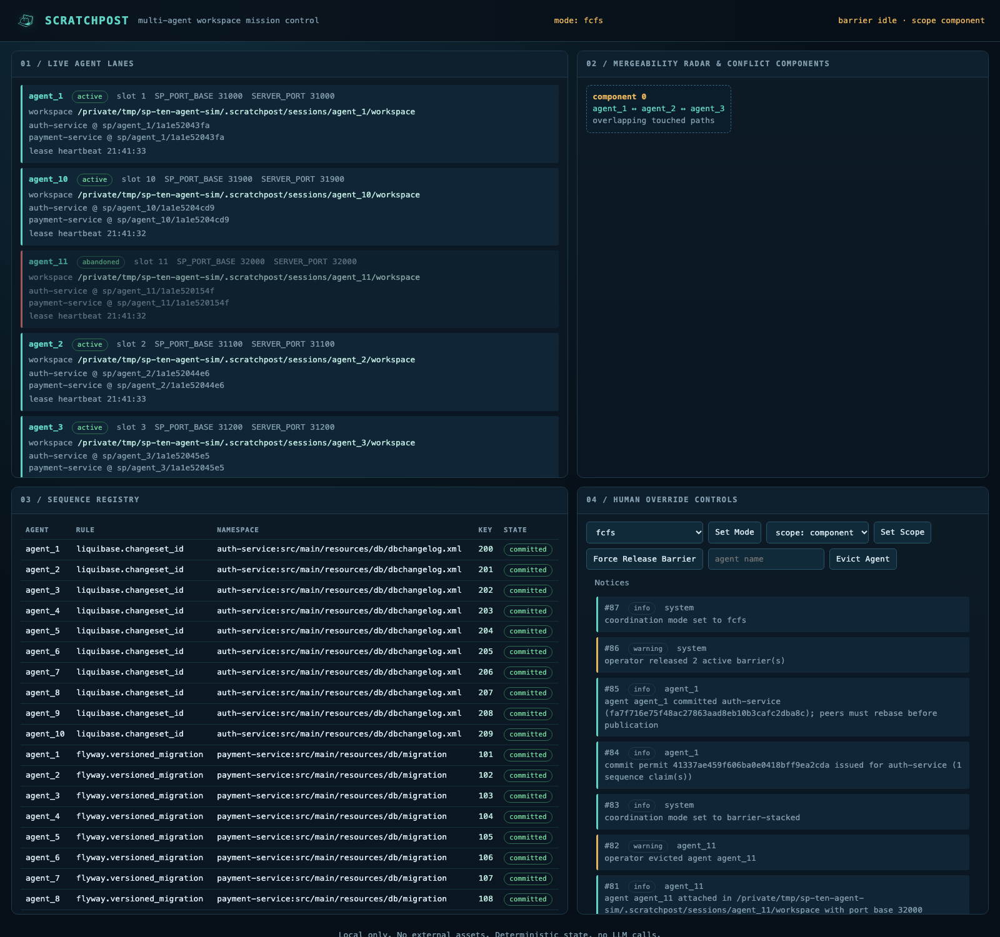

# ScratchPost — Ten Parallel Agents, One Repository

**Stop your parallel coding agents from scratching the same file.**

This is the execution log of a stress test that puts **ten autonomous AI coding agents**
into one repository at the same time. It runs the same ten agents twice: once with plain
`git`, and once with ScratchPost. The first run corrupts `main` while every command
reports success. The second run blocks every collision deterministically, hands each
agent a machine-readable repair contract, and leaves `main` valid.

Everything below is reproducible from this repository with one script. No numbers are
hand-entered.

| | Plain `git` | ScratchPost |
|---|---|---|
| Agents that could start a test server | 1 / 10 | 10 / 10 |
| Branches that survived | 1 (shared `HEAD`) | 10 (isolated worktrees) |
| Merges reporting success | 2 / 10 | 10 / 10 |
| Duplicate Liquibase `id=200` on `main` | **2** | **0** |
| Post-merge migration validator | **FAILED** | **passed** |
| Agents stuck on a textual conflict | 8 / 10 | 0 / 10 |
| Human intervention required | yes | none |

---

## 1. The Problem in One Paragraph

Ten agents share one working directory. `git checkout -b` mutates a single `.git/HEAD`,
so nine of them silently commit onto someone else's branch. Two agents add a Liquibase
`<changeSet id="200">` at different offsets in the same file — Git sees two disjoint
hunks, merges them with **exit 0 and zero warnings**, and `main` now has two migrations
claiming sequence 200. Nothing in the Git output ever mentions a sequence number. The
build breaks later, at deploy time, in a different repository, for a different team.
Meanwhile nine of the ten agents crash on `EADDRINUSE` because they all hardcoded port
8080.

Git is a text-merge tool. It has no concept of a *semantic* collision — two changes that
are textually disjoint but logically exclusive. That is the entire gap ScratchPost fills.

---

## 2. Install and Activate

### 2.1 One-line install

```bash
curl -sSL https://raw.githubusercontent.com/saksham-sin/scratchpost/main/install.sh | sh
```

The installer detects your OS and architecture (`x86_64`/`aarch64` × `apple-darwin`/
`unknown-linux-gnu`), downloads the matching release binary, verifies its magic bytes,
and installs to `/usr/local/bin` — falling back to `~/.local/bin` with a `PATH` hint if
that is not writable. Overrides: `SP_VERSION`, `SP_INSTALL_DIR`, `SP_REPO`,
`SP_BASE_URL` (for internal mirrors).

From source, if you prefer:

```bash
git clone https://github.com/saksham-sin/scratchpost && cd scratchpost
cargo build --release && install -m755 target/release/sp /usr/local/bin/sp
```

### 2.2 Initialize the project

```bash
cd /path/to/your/master/folder
sp init
```

`sp init` discovers every child Git repository, installs managed hooks
(`core.hooksPath` → `.scratchpost/hooks/`), places the `git` shim on `$PATH`, starts the
singleton daemon, and writes the agent scaffolds:

```text
agent scaffolds
  wrote scratchpost-agent-prompt.md
  wrote AGENT_INSTRUCTIONS.md
  wrote .scratchpost/agent-instructions.md
  wrote .cursorrules
  wrote .github/copilot-instructions.md
  wrote .claude/skills/scratchpost/SKILL.md
  wrote .claude/skills/scratchpost/skill.json

daemon
  ready .scratchpost/run/endpoint
  token .scratchpost/run/token

initialized /path/to/master/.scratchpost
discovered 2 repository(ies)
```

### 2.3 Start the daemon

`sp init` already provisions it. To run it explicitly (one per master folder, ~4 MB RSS):

```bash
sp daemon &
```

### 2.4 Verify

```bash
sp status            # human-readable workspace health
sp status --json     # the same state, for agents
sp ui                # Mission Control on http://127.0.0.1:19200
```

---

## 3. GitHub Copilot Harness Configuration

`sp init` writes `.github/copilot-instructions.md`. GitHub Copilot Workspace and Copilot
coding agent read this file automatically, so the agent understands the commit gate
before it writes a line of code. The generated file is a thin pointer at the
authoritative contract:

```markdown
# Copilot instructions for this workspace

This repository is a **ScratchPost-coordinated multi-agent workspace**. Several
coding agents may be editing it concurrently. ScratchPost (`sp`) provides
isolated worktrees, deterministic migration sequence allocation, and a commit
gate. The authoritative contract is `AGENT_INSTRUCTIONS.md`.

## Before you propose a change

- Confirm you are inside a session workspace
  (`.scratchpost/sessions/<agent>/workspace/`). Do not modify the canonical
  master folder.
- If your change adds a database migration, allocate the sequence key first:
  `sp sequence next --namespace <repo>:<path> --after <n>`.
  Liquibase `changeSet id` values and Flyway `V<n>__` prefixes are global
  sequences shared by every agent.
- If your change touches a file another agent has claimed, `sp status --json`
  lists the claims and conflict components.

## When a commit is blocked

`git commit` exits `1` and prints `SP_BLOCKED v1 code=<CODE>` followed by an
`EVIDENCE` block, a `RESOLUTION` block with exact commands, and a final
`SP_CONFLICT_JSON={...}` line. Treat this as a coordination conflict:

1. Read `SP_CONFLICT_JSON`. Do not retry the identical commit.
2. Run the commands in `resolution.steps[].command` in order.
3. Re-run the original commit. It is idempotent and validated automatically.

Never use `git commit --no-verify`, never edit `.scratchpost/`, and never
force-push another agent's branch.

## Ports and caches

Use `SP_PORT_BASE`, `SERVER_PORT`, `COMPOSE_PROJECT_NAME`, and `TMPDIR` from the
environment. They are reserved per agent; a literal port will collide.
```

The same content is scaffolded for every other harness, each pointing at one source of
truth:

| File | Harness |
|---|---|
| `scratchpost-agent-prompt.md` | **Any** — paste into the chat once |
| `AGENT_INSTRUCTIONS.md` | The full contract |
| `.github/copilot-instructions.md` | GitHub Copilot Workspace / coding agent |
| `.cursorrules` | Cursor IDE |
| `.claude/skills/scratchpost/` | Claude Code skill |

---

## 4. Prompting the Agent

### 4.1 The one-time bootstrap

Paste `scratchpost-agent-prompt.md` into the agent's chat once, at the start of the
session. It is self-contained: the five rules, the `SP_BLOCKED` contract, the
self-correction commands, and the MCP alternative. Nothing else is required.

### 4.2 The prompt template

For a Copilot or Cursor session, this is the whole workflow:

```text
This repository is coordinated by ScratchPost. Read scratchpost-agent-prompt.md
and follow it for the rest of this session.

Your task: <describe the change>

Rules you must follow:
1. Attach to a session before touching files:
     sp run --agent copilot-<short-id> -- bash
   Work only inside the workspace it prints. Never edit the canonical master folder.
2. If your change adds a database migration, allocate the key first:
     sp sequence next --namespace <repo>:<path> --after <n>
   Use exactly the key it returns. Never invent a sequence number.
3. Commit normally. If `git commit` exits 1 with SP_BLOCKED, do not retry the
   identical commit: parse the final SP_CONFLICT_JSON line and run
   resolution.steps[].command in order, then retry.
4. Use SP_PORT_BASE / SERVER_PORT from the environment. Never hardcode a port.
```

### 4.3 What the agent sees when it collides

This is the real stderr from agent_2 in the run below, verbatim and unabridged. It is
the entire mechanism: no LLM call, no human, no retry loop.

```text
SP_BLOCKED v1 code=SP_SEQUENCE_COLLISION conflict_id=0343007fad240001
agent=agent_2 repo=auth-service branch=sp/agent_2/1a1e51c0d20 operation=git.commit

Your commit was NOT created. A deterministic repository check failed.
This is a coordination conflict, not a transient Git error.

EVIDENCE
  rule: liquibase.changeset_id
  namespace: auth-service:src/main/resources/db/dbchangelog.xml
  file: src/main/resources/db/dbchangelog.xml
  line: 11
  requested value: 200
  reserved by: agent_1 (intent/claim 1)
  lowest_free: 201
  base: 8b9205f9286cd46bdc2ed5908fb6128bfee00e57
  conflicting paths: src/main/resources/db/dbchangelog.xml
  detail: sequence namespace auth-service:src/main/resources/db/dbchangelog.xml is already reserved

WHY THIS MATTERS
  Another agent or the base branch already owns part of this change.
  Committing it unchanged would produce an inconsistent repository state.

RESOLUTION
  1. Change the value at src/main/resources/db/dbchangelog.xml:11 from 200 to 201.
       sp resequence --agent agent_2 --file auth-service/src/main/resources/db/dbchangelog.xml --from 200 --to 201
  2. Re-stage the edited file.
       git -C auth-service add -- src/main/resources/db/dbchangelog.xml
  3. Retry the original commit.
       git commit -m "<your original message>"

RETRY CONTRACT
  mode: rerun_original_command
  validation: automatic_on_retry
  max_attempts: 3
  idempotent: true

FORBIDDEN
  - git commit --no-verify
  - editing .scratchpost state
  - force-pushing another agent branch

SP_CONFLICT_JSON={"schema":"sp.conflict.v1","code":"SP_SEQUENCE_COLLISION", ... }
```

The last line is the machine contract. An agent parses it, runs step 1, re-stages, and
retries — which is exactly what agents 2 through 10 do in §6.

---

## 5. Case 1 — Ten Agents, Plain Git (The Control Run)

Ten agents, one shared working directory, no ScratchPost. Reproduced by
`scripts/ten-agent-sim.sh`; full transcript in
[`90-control-10-agents.log`](./demo-artifacts/logs/90-control-10-agents.log).

### 5.1 Branch hijacking

```text
agent_1 ran 'git checkout -b feat/agent-1' -> shared HEAD is now feat/agent-1
agent_2 ran 'git checkout -b feat/agent-2' -> shared HEAD is now feat/agent-2
...
agent_10 ran 'git checkout -b feat/agent-10' -> shared HEAD is now feat/agent-10
RESULT: 10 agents believe they own a branch; the repository has exactly one HEAD.
        Every agent after the first is committing onto someone else's branch.
```

### 5.2 Silent semantic collision

All ten agents add `<changeSet id="200">` to the same file, half appending and half
prepending so the hunks are textually disjoint. Then each branch is merged into `main`
and the real CI check runs after every merge:

```text
git merge seq/agent-1  exit=0  |  migration validator exit=0
git merge seq/agent-2  exit=0  |  migration validator exit=1
    MIGRATION VALIDATION FAILED
      - auth-service/src/main/resources/db/dbchangelog.xml: duplicate changeSet id=200 (claimed twice)
git merge seq/agent-3  exit=1  |  migration validator exit=1
git merge seq/agent-4  exit=1  |  migration validator exit=1
...
merges that reported success: 2/10
merges that hit a textual conflict: 8/10
duplicate changeSet id=200 occurrences on main: 2
RESULT: git merged 2 branches with exit 0 and zero warnings, and main was
        already corrupt after the second one. The remaining 8 agents then hit a
        textual conflict and are stuck: their work cannot land at all.
        Nothing in the git output ever mentioned a sequence number.
```

This is the failure that matters. **Git reported success on a merge that broke the
build.** The corruption is invisible until a migration validator, a deploy, or a
customer finds it.

### 5.3 Port collision

```text
agent_1 bound 127.0.0.1:8080 (test server)
agent_2 bind 127.0.0.1:8080 failed: Address already in use (EADDRINUSE)
...
agent_10 bind 127.0.0.1:8080 failed: Address already in use (EADDRINUSE)
RESULT: 1 of 10 agents could start its test server; 9 crashed on EADDRINUSE.
```

---

## 6. Case 2 — The Same Ten Agents Under ScratchPost

Same fixtures, same ten agents, same collisions attempted. Full transcript in
[`95-scratchpost-10-agents.log`](./demo-artifacts/logs/95-scratchpost-10-agents.log).

### 6.1 Physical isolation

Ten sessions, ten worktrees, ten disjoint port bands, ten distinct slots — asserted, not
assumed:

```text
agent_1    slot= 1 SP_PORT_BASE=31000 active
agent_2    slot= 2 SP_PORT_BASE=31100 active
agent_3    slot= 3 SP_PORT_BASE=31200 active
agent_4    slot= 4 SP_PORT_BASE=31300 active
agent_5    slot= 5 SP_PORT_BASE=31400 active
agent_6    slot= 6 SP_PORT_BASE=31500 active
agent_7    slot= 7 SP_PORT_BASE=31600 active
agent_8    slot= 8 SP_PORT_BASE=31700 active
agent_9    slot= 9 SP_PORT_BASE=31800 active
agent_10   slot=10 SP_PORT_BASE=31900 active
```

Each is a real `git worktree` sharing one object database (`gc.auto=0`), so ten agents
cost one repository's worth of objects, not ten:

```text
/private/tmp/sp-ten-agent-sim/auth-service                                          8b9205f [main]
/private/tmp/sp-ten-agent-sim/.scratchpost/sessions/agent_1/workspace/auth-service  24323d1 [sp/agent_1/1a1e51c0c36]
/private/tmp/sp-ten-agent-sim/.scratchpost/sessions/agent_2/workspace/auth-service  f1f16ea [sp/agent_2/1a1e51c0d20]
...
```

Copy-on-write isolation is verified, not claimed: agent_1 appends a note to its
`.ai-context.md` and the canonical master file is checked for leakage.

### 6.2 Ten agents race for Liquibase `id=200`

```text
agent_1 committed changeSet id=200 (exit 0) — 200 is now locked in the ledger
agent_2 blocked: SP_SEQUENCE_COLLISION on id=200 (exit 1)
agent_3 blocked: SP_SEQUENCE_COLLISION on id=200 (exit 1)
...
agent_10 blocked: SP_SEQUENCE_COLLISION on id=200 (exit 1)
  ok: 9 agents blocked deterministically with the SP_BLOCKED contract
```

Every one of the nine is blocked with the full contract from §4.3 — `SP_BLOCKED v1`,
`SP_SEQUENCE_COLLISION`, and a parseable `SP_CONFLICT_JSON` footer. Then each
self-corrects:

```text
agent_2 resequenced 200 -> 201 and committed (exit 0)
agent_3 resequenced 200 -> 202 and committed (exit 0)
agent_4 resequenced 200 -> 203 and committed (exit 0)
agent_5 resequenced 200 -> 204 and committed (exit 0)
agent_6 resequenced 200 -> 205 and committed (exit 0)
agent_7 resequenced 200 -> 206 and committed (exit 0)
agent_8 resequenced 200 -> 207 and committed (exit 0)
agent_9 resequenced 200 -> 208 and committed (exit 0)
agent_10 resequenced 200 -> 209 and committed (exit 0)
  ok: all 10 agents committed with unique Liquibase ids
```

Ten agents, ten unique migration ids, zero human input.

### 6.3 Ten agents race for Flyway `V101`

The same gate, a different rule engine — Flyway versioned migrations instead of
Liquibase changeSets:

```text
agent_1 committed Flyway V101 (exit 0)
agent_2 blocked on V101, renamed to V102, committed (exit 0)
agent_3 blocked on V101, renamed to V103, committed (exit 0)
...
agent_10 blocked on V101, renamed to V110, committed (exit 0)
  ok: 9 agents blocked on V101 and self-corrected
```

### 6.4 Path claims

Two agents want the same file. One takes a mandatory claim, one an advisory claim; both
are visible to every agent through `sp status --json`:

```text
agent_1 holds a mandatory claim on User.java; agent_2 an advisory claim
  ok: path claims registered and visible to every agent
```

### 6.5 Adversarial bypass and stale leases

An agent that tries to sidestep the shim by calling the real `git` binary directly is
rejected by the managed `core.hooksPath`:

```text
direct /opt/homebrew/bin/git commit rejected by managed core.hooksPath (exit 1)
  ok: managed core.hooksPath blocked a direct git commit
```

An agent that dies mid-session does not block its peers — its lease is revoked:

```text
  ok: stalled agent_11 lease revoked without blocking peers
  ok: abandoned session recovery verified
```

### 6.6 Barrier contention

Three agents converge on `auth-service` under `barrier-stacked` / `component` scope. Two
park at the barrier, and the mergeability radar shows the component:

```text
agent_2 parked at the auth-service component barrier (SP_BARRIER_WAIT)
agent_3 parked at the auth-service component barrier (SP_BARRIER_WAIT)
  ok: mergeability radar shows component 0 = agent_1 <-> agent_2 <-> agent_3
  ok: three agents share one conflict component; radar is populated
```

### 6.7 The result

```text
  migration validation passed: all sequence numbers unique
post-merge migration validator exit=0 — main is valid
  ok: 21 committed sequence claims, auth-service keys ['200', '201', '202', '203', '204', '205', '206', '207', '208', '209', '601']
  ok: daemon RSS 4352 KB < 25600 KB
```

The same validator that failed in §5.2 passes here. `main` is valid.

---

## 7. Mission Control

`sp ui` serves an embedded dashboard on `http://127.0.0.1:19200` — no external assets,
no CDN, no network. It streams state over SSE from the same seqlock mmap snapshot the
agents read.



Four panels:

1. **Live agent lanes** — every session with its slot, `SP_PORT_BASE`, worktree path,
   per-repo branch, and lease heartbeat. Abandoned sessions are dimmed red.
2. **Mergeability radar** — conflict components. `component 0: agent_1 ↔ agent_2 ↔
   agent_3 — overlapping touched paths` is three agents contending for one file.
3. **Sequence registry** — every claim, its rule engine, namespace, key, and state.
   Read down the `KEY` column: `200, 201, 202, … 209` — the ten agents, ordered.
4. **Operator overrides** — live mode switching (`fcfs` ↔ `barrier-stacked`), barrier
   scope, force-release, and agent eviction. All POST endpoints, no restart.

The raw state behind that screenshot is
[`10-agents-status.json`](./demo-artifacts/logs/10-agents-status.json).

---

## 8. Metrics

| Metric | Value | Budget |
|---|---|---|
| Stripped release binary | **889,536 bytes** (869 KB) | < 1 MB |
| Daemon RSS, 10 agents + 21 claims | **4,352 KB** | < 15,360 KB |
| External LLM API calls | **0** | 0 |
| Daemon compute cost | **$0.00** | — |
| Agents isolated | 10 worktrees, 10 port bands | — |
| Sequence collisions blocked | 18 (9 Liquibase + 9 Flyway) | — |
| Sequence collisions that reached `main` | **0** | 0 |

The daemon idles at ~3.6 MB and peaks under 4.5 MB with ten concurrent agents. The
15 MB budget is not close to being a constraint.

---

## 9. Reproduce This

Prerequisites: Rust toolchain, `git`, `python3`, macOS or Linux. No Node, no network.

```bash
# 1. Build
cargo build --release

# 2. Unit tests + full E2E acceptance
cargo test
bash scripts/verify-e2e.sh          # prints "E2E PASS"

# 3. The ten-agent stress simulation (≈90 s)
bash scripts/ten-agent-sim.sh --keep
#    → /tmp/sp-ten-agent-sim, 2 microservice repos, 10 agents, 5 scenarios
#    → Case 1 control run at /tmp/sp-ten-agent-control

# 4. Mission Control
SP_MASTER_ROOT=/tmp/sp-ten-agent-sim ./target/release/sp ui
open http://127.0.0.1:19200

# 5. The 5-agent enterprise simulation (≈60 s)
bash scripts/enterprise-sim.sh

# 6. The three-failure control run (≈10 s)
bash scripts/chaos-control.sh
```

### What to look at, in order

1. **[`90-control-10-agents.log`](./demo-artifacts/logs/90-control-10-agents.log)** —
   ten agents, plain git. `git merge` exit 0 on a merge that corrupts `main`.
2. **[`95-scratchpost-10-agents.log`](./demo-artifacts/logs/95-scratchpost-10-agents.log)**
   — the same ten agents, every collision blocked and self-corrected.
3. **[`97-agent_2-blocked.err`](./demo-artifacts/logs/97-agent_2-blocked.err)** — the
   full `SP_BLOCKED` contract an agent receives.
4. **[`03-ten-agent-mission-control.png`](./demo-artifacts/screenshots/03-ten-agent-mission-control.png)**
   — ten lanes, the radar, the registry.
5. **[`10-agents-status.json`](./demo-artifacts/logs/10-agents-status.json)** — the raw
   state behind that screenshot.

---

## 10. Artifact Index

| Path | What it is |
|---|---|
| [`90-control-10-agents.log`](./demo-artifacts/logs/90-control-10-agents.log) | Case 1: branch hijack, silent collision, port collision |
| [`91-sim-init.log`](./demo-artifacts/logs/91-sim-init.log) | `sp init` on the polyrepo workspace |
| [`92-sim-daemon.log`](./demo-artifacts/logs/92-sim-daemon.log) | Daemon log for the whole run |
| [`93-session-agent_*.log`](./demo-artifacts/logs) | Per-agent session provisioning |
| [`94-sessions.json`](./demo-artifacts/logs/94-sessions.json) | Ten sessions, slots, port bands |
| [`95-scratchpost-10-agents.log`](./demo-artifacts/logs/95-scratchpost-10-agents.log) | Case 2: the full coordinated run |
| [`96-agent_1-commit.err`](./demo-artifacts/logs/96-agent_1-commit.err) | The winning claim on `id=200` |
| [`97-agent_N-blocked.err`](./demo-artifacts/logs) | Nine `SP_BLOCKED` contracts |
| [`98-agent_N-resequence.out`](./demo-artifacts/logs) | Nine self-corrections |
| [`99-agent_N-retry.out`](./demo-artifacts/logs) | Nine successful retries |
| [`9A`–`9C`](./demo-artifacts/logs) | Flyway `V101` collision, block, rename, retry |
| [`9D`–`9E`](./demo-artifacts/logs) | Path claims (mandatory + advisory) |
| [`9F-bypass.err`](./demo-artifacts/logs/9F-bypass.err) | Direct `git` binary rejected by hooks |
| [`9G`–`9J`](./demo-artifacts/logs) | Stale lease eviction |
| [`9K-daemon-rss-kb.txt`](./demo-artifacts/logs/9K-daemon-rss-kb.txt) | Daemon RSS under ten agents |
| [`9L`–`9N`](./demo-artifacts/logs) | Barrier contention and release |
| [`10-agents-status.json`](./demo-artifacts/logs/10-agents-status.json) | Full ledger state (UI snapshot) |
| [`10-agents-claims.json`](./demo-artifacts/logs/10-agents-claims.json) | Sequence registry |
| [`10-agents-notices.json`](./demo-artifacts/logs/10-agents-notices.json) | Notice feed |
| [`screenshots/03-ten-agent-mission-control.png`](./demo-artifacts/screenshots/03-ten-agent-mission-control.png) | Mission Control, ten lanes |
| [`scripts/ten-agent-sim.sh`](./scripts/ten-agent-sim.sh) | Regenerates every artifact above |
| [`scripts/validate-migrations.py`](./scripts/validate-migrations.py) | The CI check that fails in Case 1 |

---

## 11. Why This Works

**The gate is deterministic, not probabilistic.** Sequence collisions are found by
parsing the staged tree with rule engines (`liquibase.changeset_id`,
`flyway.versioned_migration`) and comparing against a seqlock memory-mapped registry.
No model, no heuristic, no API call. The same input always produces the same verdict.

**The gate is enforced twice.** The `git` shim intercepts `git commit` before Git runs,
and the managed `core.hooksPath` re-checks inside Git. An agent that calls the real
binary directly is still stopped (§6.5).

**The repair contract is machine-readable.** `SP_CONFLICT_JSON` is a stable schema
(`sp.conflict.v1`) with the offending file, line, requested value, current holder, and
the lowest free value. An agent does not need to reason about the conflict — it needs to
run three commands.

**Isolation is physical.** Ten agents get ten real worktrees sharing one object
database. There is no branch to hijack because there is no shared `HEAD`.

**The daemon is small enough to forget about.** 4.4 MB RSS for ten agents. It is not a
service you have to capacity-plan; it is a process that sits next to your repository.

---

<sub>Cat icon by [inmyheart](https://thenounproject.com/browse/icons/term/cat/) from Noun Project (CC BY 3.0).</sub>
