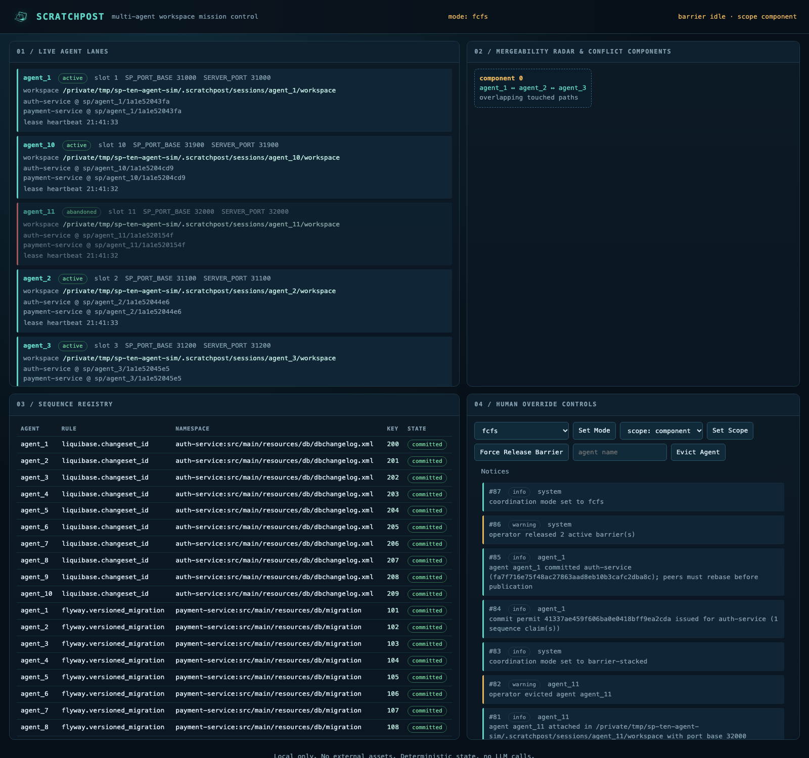
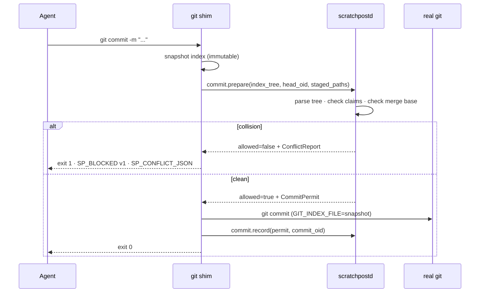

<div align="center">


# ScratchPost

**Stop your parallel coding agents from scratching the same file.**

A single-binary Rust workspace coordinator for AI coding agents.
Isolated worktrees · deterministic migration sequences · a commit gate that
refuses to let two agents corrupt `main`.

[](https://github.com/saksham-sin/scratchpost/actions/workflows/ci.yml)
[](LICENSE)
[](https://www.rust-lang.org)

[Quick start](#quick-start) · [The problem](#the-problem) · [How it works](#how-it-works) · [Results](#results) · [Docs](#documentation)

</div>

---

## The problem

You run five AI coding agents in parallel in one workspace. Three things break,
and none of them are reported by Git:

```text
agent_1  git checkout -b feat/oauth     →  .git/HEAD now says feat/oauth
agent_2  git checkout -b feat/mfa       →  .git/HEAD now says feat/mfa
                                            agent_1 is committing onto agent_2's branch
```

```text
agent_1  adds <changeSet id="200">  (appended)
agent_2  adds <changeSet id="200">  (prepended)

git merge  →  exit 0, zero conflicts, zero warnings
main       →  two migrations claiming sequence 200
```

Git is a **text**-merge tool. It has no concept of a *semantic* collision — two
changes that are textually disjoint but logically exclusive. The build breaks
later, at deploy time, in a different repository, for a different team.

ScratchPost is the missing layer: it gives every agent a private worktree, a
private port band, and a commit gate that understands what the code *means*.

## Results

Ten agents, one repository, the same collisions attempted. Measured, not
estimated — reproduce with `bash scripts/ten-agent-sim.sh`.

| | Plain `git` | ScratchPost |
|---|---|---|
| Agents that could start a test server | 1 / 10 | **10 / 10** |
| Branches that survived | 1 (shared `HEAD`) | **10** (isolated worktrees) |
| Merges reporting success | 2 / 10 | **10 / 10** |
| Duplicate Liquibase `id=200` on `main` | **2** | **0** |
| Post-merge migration validator | **FAILED** | **passed** |
| Agents stuck on a textual conflict | 8 / 10 | **0 / 10** |
| Human intervention required | yes | **none** |

<div align="center">

<br/>
<sub>Mission Control: ten live agent lanes, the mergeability radar, and the sequence registry reading <code>200, 201, 202 … 209</code> — the ten agents, ordered.</sub>
</div>

## Quick start

```sh
# 1. Install
curl -sSL https://raw.githubusercontent.com/saksham-sin/scratchpost/main/install.sh | sh

# 2. Initialize your master folder (discovers child repos, installs hooks, starts the daemon)
cd /path/to/your/master/folder
sp init

# 3. Attach an agent
sp shell --agent agent_1
```

That is the whole setup. `sp init` writes the agent scaffolds, so your agent
already knows the rules.

<details>
<summary><b>Build from source instead</b></summary>

```sh
git clone https://github.com/saksham-sin/scratchpost
cd scratchpost
cargo build --release
install -m755 target/release/sp /usr/local/bin/sp
```

Requires Rust 1.75+. No Node, no Python runtime, no network access at runtime.
</details>

## How it works

### 1. Every agent gets a real worktree

No shared `HEAD` means no branch to hijack. Ten agents cost one repository's
worth of objects, not ten.

```text
/workspace/auth-service                                          8b9205f [main]
/workspace/.scratchpost/sessions/agent_1/workspace/auth-service  24323d1 [sp/agent_1/1a1e51c0c36]
/workspace/.scratchpost/sessions/agent_2/workspace/auth-service  f1f16ea [sp/agent_2/1a1e51c0d20]
...
```

Each session also gets a disjoint port band, so ten concurrent `npm test` runs
do not fight over 8080:

| Variable | agent_1 | agent_2 | agent_10 |
|---|---|---|---|
| `SP_PORT_BASE` | 31000 | 31100 | 31900 |
| `SERVER_PORT` | 31000 | 31100 | 31900 |
| `COMPOSE_PROJECT_NAME` | `sp_agent_1_1` | `sp_agent_2_2` | `sp_agent_10_10` |

### 2. The commit gate understands sequences

When an agent commits, the daemon parses the staged tree with deterministic rule
engines and compares it against the sequence registry and the merge base. No
model, no heuristic, no API call.



### 3. A blocked commit is a repair instruction, not an error

The agent does not need to reason about the conflict. It needs to run three
commands. This is the real stderr, unabridged:

```text
SP_BLOCKED v1 code=SP_SEQUENCE_COLLISION conflict_id=0343007fad240001
agent=agent_2 repo=auth-service branch=sp/agent_2/1a1e51c0d20 operation=git.commit

Your commit was NOT created. A deterministic repository check failed.
This is a coordination conflict, not a transient Git error.

EVIDENCE
  rule: liquibase.changeset_id
  namespace: auth-service:src/main/resources/db/dbchangelog.xml
  file: src/main/resources/db/dbchangelog.xml
  line: 11
  requested value: 200
  reserved by: agent_1 (intent/claim 1)
  lowest_free: 201

RESOLUTION
  1. Change the value at src/main/resources/db/dbchangelog.xml:11 from 200 to 201.
       sp resequence --agent agent_2 --file auth-service/src/main/resources/db/dbchangelog.xml --from 200 --to 201
  2. Re-stage the edited file.
       git -C auth-service add -- src/main/resources/db/dbchangelog.xml
  3. Retry the original commit.
       git commit -m "<your original message>"

RETRY CONTRACT
  mode: rerun_original_command
  validation: automatic_on_retry
  max_attempts: 3
  idempotent: true

SP_CONFLICT_JSON={"schema":"sp.conflict.v1","code":"SP_SEQUENCE_COLLISION", ... }
```

The last line is the machine contract. In the ten-agent run, agents 2 through 10
each parse it, resequence, and retry — landing on `201` through `209` with zero
human input.

## Agent-first by design

ScratchPost is built for agents, not for humans typing commands. `sp init`
scaffolds every harness, each pointing at one source of truth:

| File | Harness |
|---|---|
| `scratchpost-agent-prompt.md` | **Any** — paste into the chat once |
| `AGENT_INSTRUCTIONS.md` | The full contract |
| `.github/copilot-instructions.md` | GitHub Copilot Workspace / coding agent |
| `.cursorrules` | Cursor IDE |
| `.claude/skills/scratchpost/` | Claude Code skill |

Paste the bootstrap prompt once and the agent knows: attach to a session, never
invent a sequence number, and how to parse `SP_BLOCKED`.

### MCP

Shell-less agents use `sp --mcp` (JSON-RPC over stdio):

| Tool | Purpose |
|---|---|
| `sp_status` | Workspace health, active slots, open barriers |
| `sp_claim` | Register an advisory or mandatory path/sequence claim |
| `sp_resequence` | Resolve a sequence collision by shifting IDs |
| `sp_barrier_arrive` | Synchronize completion in barrier modes |
| `sp_commit` | Commit through the same gate as the Git shim |
| `sp_notices` · `sp_sequence_next` · `sp_sync` · `sp_config_set` · `sp_evict` | The rest of the surface |

A blocked tool returns `isError: true` with the identical `sp.conflict.v1`
contract in `structuredContent` — the same payload the CLI prints.

## Mission Control

`sp ui` serves an embedded dashboard on `http://127.0.0.1:19200`. No external
assets, no CDN, no network. It streams state over SSE from the same seqlock mmap
snapshot the agents read.

| Panel | What it shows |
|---|---|
| **Live agent lanes** | Every session: slot, `SP_PORT_BASE`, worktree, per-repo branch, lease heartbeat |
| **Mergeability radar** | Conflict components — which agents are contending for which paths |
| **Sequence registry** | Every claim: rule engine, namespace, key, state |
| **Operator overrides** | Live mode switching, barrier release, agent eviction — no restart |

## Coordination modes

```sh
sp config --mode fcfs                 # first-come-first-serve, live broadcast to peers
sp config --mode barrier-stacked      # agents wait for their component, daemon orders commits
sp config --mode barrier-integration  # all branches merge into one integration branch
sp config --barrier-scope component   # only agents touching overlapping paths wait
```

Mode changes apply immediately — the daemon updates the seqlock snapshot and the
UI reflects it without a restart.

## Performance

| Metric | Value |
|---|---|
| Stripped release binary, macOS arm64 | **869 KB** |
| Stripped release binary, Linux x86_64 | **1.13 MB** |
| Daemon RSS, idle | **~3.6 MB** |
| Daemon RSS, 10 concurrent agents | **~4.5 MB** |
| Seqlock mmap status read | **~2.9 ms** |
| Commit gate overhead | **~105 ms p50** |
| External LLM API calls | **0** |

The binary is larger on Linux because glibc pulls in more than libSystem; the
same source, same profile (`opt-level="z"`, `lto="fat"`, `strip="symbols"`).

The gate overhead is above the original 50 ms target — atomic subprocess plumbing
and WAL fsync. It is documented honestly rather than hidden; see
[DEMO_REPORT.md](DEMO_REPORT.md) §7.1.

## Documentation

| Document | What it covers |
|---|---|
| [DEMO_REPORT_10_AGENTS.md](DEMO_REPORT_10_AGENTS.md) | **Start here.** Ten-agent stress test, install guide, Copilot setup, transcripts |
| [DEMO_REPORT.md](DEMO_REPORT.md) | The five-agent enterprise simulation and the empirical scorecard |
| [docs/ARCHITECTURE.md](docs/ARCHITECTURE.md) | Process topology, module map, state layout, the commit gate |
| [SCRATCHPOST_RFC.md](SCRATCHPOST_RFC.md) | Architecture, failure-mode analysis, wire protocol, ledger schema |
| [SCRATCHPOST_RFC_REVIEW.md](SCRATCHPOST_RFC_REVIEW.md) | Adversarial review of the design |
| [CONTRIBUTING.md](CONTRIBUTING.md) | Build, test, lint, and the ground rules |
| [SECURITY.md](SECURITY.md) | Threat model — what ScratchPost does and does not defend against |
| [CHANGELOG.md](CHANGELOG.md) | Release history |

## CLI

```sh
# workspace
sp init                                  # discover repos, install hooks, start daemon
sp daemon                                # run the singleton daemon
sp status [--json]                       # workspace health
sp ui                                    # Mission Control on 127.0.0.1:19200

# sessions
sp shell --agent <name>                  # isolated worktree + port band + caches
sp run --agent <name> -- <command...>    # one command in a session
sp evict --agent <name>                  # revoke an abandoned lease

# coordination
sp claims [--json]
sp claim --agent <name> --repo <repo> --path <path> [--strength advisory|mandatory]
sp claim --agent <name> --release
sp barrier status|arrive|release [--scope workspace|component]
sp notices [--json]

# sequences
sp sequence next --namespace <name> --after <n>
sp resequence --agent <name> --file <relative> --from <key> --to <key>
sp sync --rebase --agent <name> [--repo <name>]

# configuration
sp config --mode <fcfs|barrier-stacked|barrier-integration>
sp instructions [--print]
sp --mcp
```

## Verification

```sh
cargo test                    # 18 unit tests
bash scripts/verify-e2e.sh    # two-agent acceptance harness → "E2E PASS"
bash scripts/ten-agent-sim.sh # ten-agent stress simulation → "SIM PASS"
bash scripts/enterprise-sim.sh# five agents, three microservices → "SIM PASS"
bash scripts/chaos-control.sh # the same failures without ScratchPost
bash scripts/bench.sh         # regenerate the scorecard on your hardware
```

Every number in this README is regenerated by one of those scripts. Nothing is
hand-entered.

## Security model

The shim snapshots the index and passes an immutable `GIT_INDEX_FILE` to the real
Git process; the daemon binds a short-lived `CommitPermit` to that tree, and
managed `pre-commit`/`pre-push` hooks reject unmanaged Git invocations. This
stops accidental agent bypasses and TOCTOU index changes.

ScratchPost is a **coordination** tool, not a sandbox. As with any user-level Git
hook, an agent that invokes the real Git binary with `--no-verify` can bypass
hooks — run agents inside `sp shell` so the shim is authoritative. It
intentionally does not attempt kernel-level isolation. See
[SECURITY.md](SECURITY.md).

## License

[Apache License 2.0](LICENSE).

<div align="center">
<sub>
The ScratchPost mark is a cat resting on a laptop by
<a href="https://thenounproject.com/browse/icons/term/cat/">inmyheart</a> from
Noun Project, used under
<a href="https://creativecommons.org/licenses/by/3.0/">CC BY 3.0</a>.
</sub>
</div>
