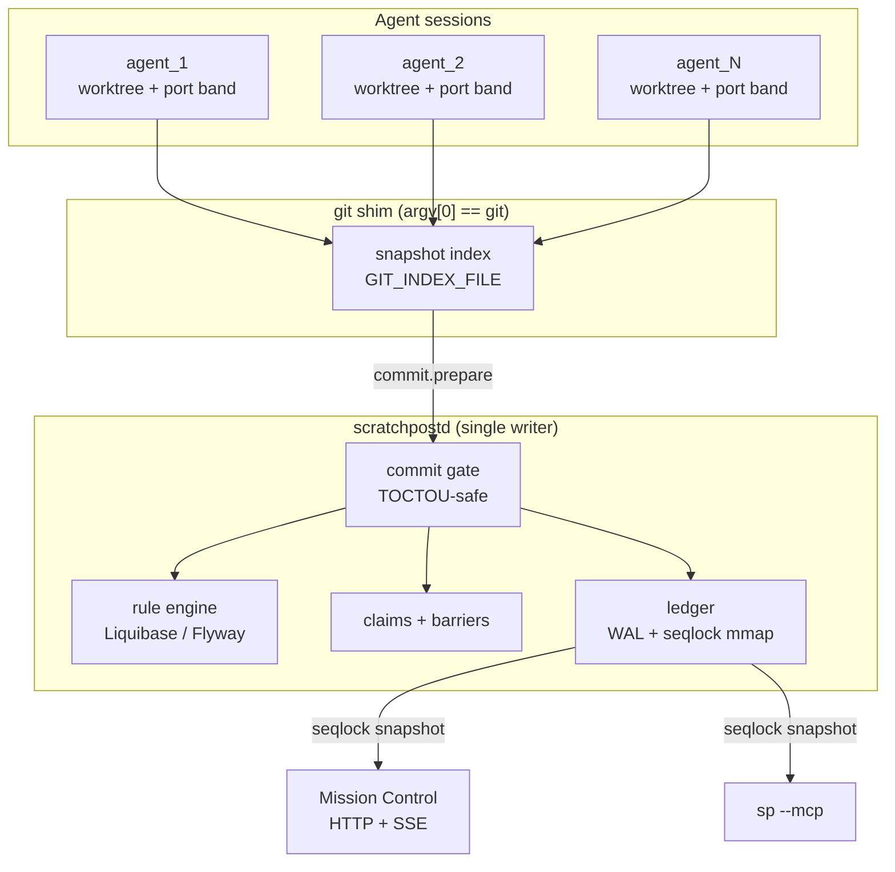
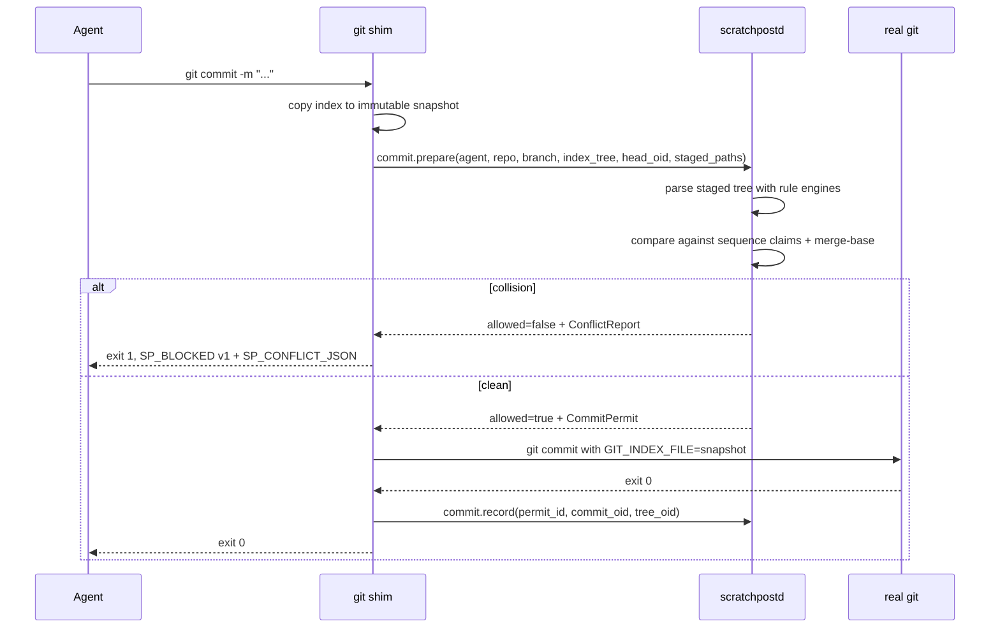

# Architecture

ScratchPost is one binary that behaves as four programs depending on how it is
invoked:

| `argv[0]` / flag | Role |
|---|---|
| `sp` | CLI client |
| `scratchpostd` | the singleton daemon |
| `git` | the interception shim |
| `sp --mcp` | MCP JSON-RPC server over stdio |

The daemon is the only writer of state. Everything else is a client of it over a
Unix-domain socket.

## Process topology



## Modules

| Module | Responsibility |
|---|---|
| `protocol` | Versioned ledger, RPC, permit, conflict, and notice types |
| `workspace` | Master discovery, state layout, socket endpoint, hooks, CoW copies |
| `ledger` | Double-buffered seqlock mmap snapshot and append-only WAL |
| `git_engine` | Sanitized real-Git subprocesses and worktree operations |
| `rules` | Liquibase/Flyway sequence extraction and allocation |
| `prompt` | Deterministic passive conflict-resolution output |
| `session` | Worktree, context, cache, and resource-band provisioning |
| `daemon` | Single-writer authority, commit gate, claims, barriers, WAL replay |
| `shim` | `git` interception, index snapshot, hooks, permit execution |
| `client` | Unix-domain socket RPC and notice cursor |
| `agents` | Agent-first documentation and harness scaffold generator |
| `audit` | Append-only audit log and `RUNNING_REPORT.md` renderer |
| `style` | Terminal presentation: colour gating, headers, aligned key/value blocks |
| `mcp` | MCP JSON-RPC stdio transport and tools |
| `ui` | Embedded HTTP/SSE Mission Control server |
| `cli` | Command surface and session child environment |

## State layout

```text
.scratchpost/
├── config.json          # mode, barrier scope, port bands, ui_port
├── ledger.wal           # append-only recovery source (authoritative)
├── ledger.mmap          # double-buffered seqlock snapshot (read path)
├── audit.log            # JSONL coordination audit trail
├── bulletin.md          # mutation broadcast for peers
├── daemon.lock          # flock guard, one daemon per master folder
├── hooks/               # managed core.hooksPath
├── bin/                 # sp, scratchpostd, git shim
├── run/
│   ├── endpoint         # Unix socket path
│   ├── token            # capability token, mode 0600
│   └── daemon.pid
└── sessions/
    └── <agent>/
        ├── workspace/   # physical session root
        └── index-*.snapshot
```

The Unix socket lives at `/tmp/sp/<uid>/<workspace-hash>.sock`, outside the
workspace, so a long path cannot exceed the socket path limit.

## The commit gate

The gate is the reason the project exists. It runs in two places, so an agent
that calls the real `git` binary directly is still stopped.



The permit is bound to the exact tree that was validated. If the index changes
between validation and execution, the permit no longer matches and the commit is
rejected — this is the TOCTOU defence.

## Ledger

State is written only by `scratchpostd`:

- **WAL** (`.scratchpost/ledger.wal`) — append-only, the recovery source. Replayed
  on daemon start.
- **mmap snapshot** (`.scratchpost/ledger.mmap`) — double-buffered seqlock. Readers
  never block and never take a lock; a torn read is detected by the sequence
  counter and retried.

Status reads are ~2.9 ms. The daemon runs a fixed 16-thread RPC pool; it never
spawns a thread per connection.

## Coordination modes

| Mode | Behaviour |
|---|---|
| `fcfs` | First-come-first-serve. A commit is admitted as soon as it validates; peers are notified to rebase. |
| `barrier-stacked` | Agents arriving at a barrier wait for their conflict component. The daemon orders commits and assigns stacked sequence keys. |
| `barrier-integration` | All agent branches merge into one consolidated `integration/<feature>` branch per repository. |

Barrier scope is `workspace` (all agents) or `component` (only agents touching
overlapping paths), so orthogonal agents never wait on each other.

## Design contracts

The full architecture, failure-mode analysis, wire protocol, ledger schema, and
passive conflict prompt contract are in
[SCRATCHPOST_RFC.md](../SCRATCHPOST_RFC.md). Internal modules use
systems-engineering terminology; the ScratchPost name and tagline are the only
product-level metaphor.
